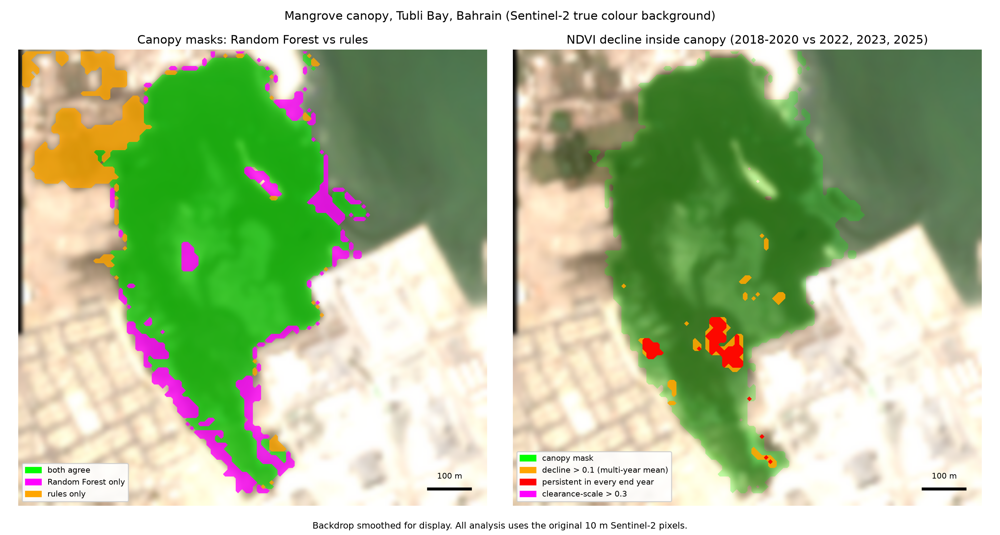
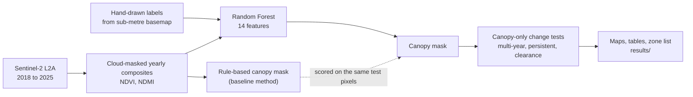
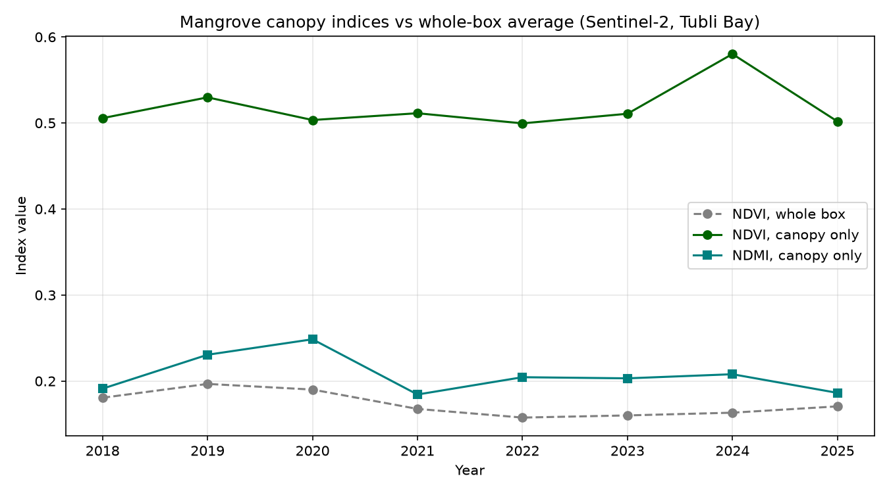

# 813 Mangrove Monitoring

**Team Hmm** · Arab Youth Space Hackathon: 813 Challenge · **Theme:** Ecosystem Health, Biodiversity & Blue Carbon · **Track:** Very High Resolution (VHR)

> A reproducible notebook that maps the mangrove canopy of a stand on the Tubli Bay coast (Bahrain) with a Random Forest trained on hand-labelled polygons, then tests inside that canopy, against a noise floor, whether it changed between 2018 and 2025, using free Sentinel-2 data.



*Left: where the Random Forest and a rule-based NDVI/NDWI mask agree and disagree. Right: NDVI decline tests inside the canopy. Both on a Sentinel-2 true-colour background.*

---

## Business use case

**Who:** environmental authorities and conservation managers responsible for Bahrain's remaining mangroves, and groups running mangrove restoration. Tubli Bay is a marine protected area and a Ramsar site ([Gulf Daily News](https://www.gdnonline.com/Details/1360354/Crucial-role-of-mangroves-in-climate-change-highlighted-)), and Bahrain has set a goal of quadrupling its mangrove cover by 2035 (same source). These are hypothesised users: we have not interviewed them, and the use case is our reading of public sources.

**Decision they make:** where to send field teams and inspectors, whether a stand is holding steady or losing canopy, and what baseline to use for restoration tracking and blue-carbon accounting.

**What is used today (as far as public sources show):** periodic studies that digitise satellite imagery by hand. The University of Bahrain assessment cited below used ArcGIS to digitise mangrove areas across imagery from 1967 to 2020.

**What this PoC adds:** a repeatable pipeline that, from free data and in minutes, returns the canopy area, a change test that is compared with a noise floor so ordinary variability is not mistaken for loss, and a short list of locations worth checking on sub-metre imagery.

## The problem

Bahrain has lost more than 95% of its natural mangrove cover. A University of Bahrain study of the Tubli Bay area reports a decline from 328 ha in 1967 to 48 ha in 2020, mainly from land reclamation for urban development ([University of Bahrain Digital Repository](https://digitalrepository.uob.edu.bh/dar/assessing-spatiotemporal-changes-associated-carbon-stock-and-potential-emissions-mangroves)). The same finding is cited in a 2023 paper in *Land* ([MDPI](https://www.mdpi.com/2073-445x/12/11/2055)).

What remains is small, sits on a shoreline between water, mudflat, farmland and industrial land, and is hard to survey often. Satellites suit this: free and frequent (Sentinel-2 revisits every few days), consistent over years, and able to cover the whole coast. The catch is that a naive NDVI change calculation over a bounding box produces false alarms, because water, tide, farmland and buildings dominate the box. During development, a bay-wide box flagged hundreds of hectares of "decline", more than all the mangrove in Bahrain. This PoC is built around avoiding that failure: map the canopy first, then measure change only inside it, and always compare with a noise floor. (That early bay-wide run is a development note, not part of the notebook.)

## Data used

| Dataset | Provider | Product / ID | Dates | Processing level | Licence / terms | Used for |
|---|---|---|---|---|---|---|
| Sentinel-2 surface reflectance | ESA / Copernicus, accessed via Google Earth Engine | `COPERNICUS/S2_SR_HARMONIZED` | 2018-01-01 to 2025-12-31 (one composite per year) | Level-2A | Copernicus Sentinel data are free and open; Earth Engine access is subject to the Earth Engine terms | All imagery analysis. Scenes with `CLOUDY_PIXEL_PERCENTAGE` below 30, plus a QA60 cloud/cirrus mask |
| Training labels | Team Hmm | `data/labels/*.geojson` | n/a | Hand-drawn polygons | Our own work | Training and testing the Random Forest |
| Public sub-metre basemap | Google (Google Earth / geemap `HYBRID` basemap) | n/a | n/a | n/a | Viewing only; terms of the provider apply; imagery is **not** redistributed here | Drawing the labels and visually checking the results |

### Why Sentinel-2, and where VHR and hyperspectral data fit

The hackathon's Data Page recommends starting with Sentinel-2 or Landsat for baseline work and moving to other sensors only when the problem needs them. We followed that, and chose each source for a reason:

- **Sentinel-2 (the analysis).** 10 m pixels, a revisit of about 5 days, and an archive covering our whole 2018-2025 window. That depth is what lets the change test be compared with a noise floor instead of trusting two dates.
- **Sub-metre imagery (labels and checking).** Used to draw the training polygons and to inspect flagged patches. It is not the input to the time series: the sub-metre views available to us are a handful of dates across 2018-2025, which suits labeling and spot checks but not a per-pixel, year-by-year comparison.
- **PlanetScope (3-4 m, daily).** Not used in this PoC. It is the natural next step for a finer time series where sponsored access allows.
- **Hyperspectral (EnMAP, Tanager, Satellite 813): not used.** Their pixels are 20-30 m, coarser than Sentinel-2, so a stand of a few tens of hectares gets far fewer pixels (a 30 ha stand is about 330 pixels at 30 m, against about 3,000 at 10 m). The Data Page lists a revisit of about 27 days for EnMAP and none for Satellite 813, and all three missions launched after our 2018 start year, so they cannot supply the 8-year baseline the change test needs. The question here, whether the canopy is still there, also does not depend on fine spectral detail. Hyperspectral data would suit the follow-up questions: species and vigour, salinity or water stress, and early stress before canopy is lost.

## Technical approach



In execution order (all parameters are at the top of the notebook):

1. **Study area.** A ~1.1 km x 1.1 km box (~119 ha) around the mangrove stand, centred at about 26.150 N, 50.593 E (the stand Google Earth labels "Bahrain Mangrove Forest"). Saved to `data/sample_input/aoi.geojson`.
2. **Yearly composites.** For each year 2018-2025: Sentinel-2 L2A, scene cloud filter below 30%, QA60 cloud/cirrus mask, median composite, then NDVI = (B8-B4)/(B8+B4) and NDMI = (B8-B11)/(B8+B11).
3. **Rule-based canopy mask (baseline).** A pixel is canopy if NDVI > 0.25 in at least 6 of 8 years, median NDWI < 0 (not water), and it belongs to a connected patch of at least 8 pixels.
4. **Random Forest canopy mask.** Earth Engine `smileRandomForest`, 200 trees, seed 42. Features (14): median of bands B2-B8, B11, B12; NDWI; NDMI; and the mean, standard deviation and minimum of NDVI across 2018-2025. Classes: canopy vs not canopy, from one hand-traced polygon per class: the canopy outline, and the rest of the AOI around it (farmland, water, intertidal flats, sand, housing and industrial land). Training pixels are balanced between classes, and small patches (< 8 pixels) are removed.
5. **Testing.** The notebook is built to hold out whole polygons (70% train, 30% test) so correlated neighbouring pixels do not leak between train and test. With only one polygon per class, that split is not possible, so the notebook falls back to a random 70/30 split of pixels and prints a warning. That is what the committed results use, and it makes the accuracy optimistic. The rule-based mask is scored on the same test pixels.
6. **Canopy-only time series.** Mean NDVI and NDMI inside the active canopy mask per year, compared with the whole-box mean.
7. **Change detection inside the canopy.**
   - *Consecutive-year noise floor:* the decline test between neighbouring years, which exposes odd composites.
   - *Multi-year comparison:* mean NDVI of 2018-2020 (baseline) vs 2022, 2023 and 2025 (end; 2024 is skipped as an NDVI outlier), with 2021-2023 vs baseline as a control.
   - *Persistent decline:* a pixel counts only if it is below the baseline in every end year.
   - *Clearance-scale loss:* an NDVI drop larger than 0.3, the size of change expected when canopy becomes bare ground, water or buildings.
8. **Outputs.** Static figures, CSV tables, a `summary.json`, and a list of flagged patches with coordinates for visual checking.

## Installation

Requires **Python 3.12** (tested), plus an Earth Engine account.

```bash
git clone https://github.com/TheshadowM707/813-mangrove-monitoring
cd 813-mangrove-monitoring
python -m venv .venv
source .venv/bin/activate          # Windows: .venv\Scripts\activate
pip install -r requirements.txt
```

**Earth Engine access** (needed because the imagery is processed in Earth Engine): sign up for an Earth Engine account and make sure you have a Google Cloud project registered for Earth Engine (see [Earth Engine access](https://developers.google.com/earth-engine/guides/access)). Then set your project ID as an environment variable. No keys or tokens are stored in this repository.

```bash
export GEE_PROJECT_ID=your-project-id      # Windows (PowerShell): $env:GEE_PROJECT_ID="your-project-id"
```

Or create a `.env` file in the repository root from `.env.example` and set the value of `GEE_PROJECT_ID` there. Editors that load `.env` files (such as VS Code with the Python and Jupyter extensions) pass it to the notebook automatically, and `.env` is gitignored so your project ID stays out of the repository.

```bash
cp .env.example .env                       # Windows (PowerShell): Copy-Item .env.example .env
# then edit .env:  GEE_PROJECT_ID=your-project-id
```

Non-commercial projects must complete a short eligibility questionnaire in the Google Cloud console before they work, so allow time for setup. If you cannot get access, `results/` holds the committed outputs of a complete run for comparison.

The first run opens a browser login to authorise Earth Engine. In Colab or an existing Jupyter session, run `%env GEE_PROJECT_ID=your-project-id` in a cell before the notebook.

## How to run

```bash
jupyter lab notebooks/02_main_analysis.ipynb
```

Run all cells. Nothing needs editing: the training labels are loaded from `data/labels/`. Runtime: about 5 minutes (4 min 50 s in our run), dominated by Earth Engine calls. No GPU is needed. At the end, `results/` contains the figures, tables and `summary.json`, and the notebook's last code cell prints the headline numbers.

## Example input and output

**Input** (`data/sample_input/`, plus labels in `data/labels/`):
- `aoi.geojson`: the study-area polygon.
- `example_scene.tif`: multi-year median Sentinel-2 bands (B2, B3, B4, B8, B11) clipped to the AOI, 10 m, EPSG:32639. Written by section 11 of the notebook and small enough to commit.
- `data/labels/canopy_polygons.geojson`, `other_polygons.geojson`: the training polygons.

**Output** (`results/`): the files below. The notebook needs Earth Engine to run, so the committed copies are also the reference for what a correct run produces.

| File | What it is |
|---|---|
| `example_output.png` | Canopy mask comparison and change map (figure above) |
| `canopy_timeseries.png` | Canopy-only NDVI/NDMI per year vs the whole-box average |
| `rf_feature_importance.png` | Which of the 14 features the Random Forest used |
| `accuracy_rules_vs_random_forest.csv` | Held-out accuracy, rule-based mask vs Random Forest |
| `multi_year_change_table.csv`, `consecutive_year_noise_floor.csv` | Change tests and their noise floors |
| `persistent_decline_zones.csv` | Flagged patches with coordinates |
| `summary.json` | All headline numbers |

## Results and limitations

### Headline results

From `results/summary.json`.

| Quantity | Value |
|---|---|
| Canopy mapped (Random Forest) | 37.8 ha, in a 119.3 ha AOI. The rule-based mask also maps 37.8 ha, but the two overlap by IoU 0.78 (each includes roughly 4 to 5 ha the other leaves out) |
| Canopy F1 on held-out test pixels: rule-based vs Random Forest | 0.895 vs 0.978 (overall accuracy 0.933 vs 0.986; kappa 0.846 vs 0.968). **Pixel-level split, so optimistic** |
| Mean canopy NDVI, 2018-2020 vs 2022, 2023, 2025 | 0.513 vs 0.504 (change -0.009). The control period 2021-2023 is 0.507 |
| Decline > 0.1: end-vs-baseline / persistent in every end year / control | 1.44 ha (3.8% of canopy) / 0.81 ha / 0.73 ha |
| Persistent clearance-scale loss (NDVI drop > 0.3) | 0 ha |

**What the numbers show.** Canopy NDVI is essentially flat: the -0.009 change sits inside the normal year-to-year spread (0.50 to 0.53 in 2018-2023 and 2025). A small decline does exist. 1.44 ha of the canopy dropped by more than 0.1 NDVI, about twice the control comparison (0.73 ha), and the gap is wider at larger drops (0.56 ha vs 0.13 ha at 0.15). Part of that difference is expected, because the end period is further from the baseline than the control period is. 0.81 ha is below the baseline in every end year, and 0.58 ha of it is one patch near 26.1489 N, 50.5928 E (zone Z1 in `results/persistent_decline_zones.csv`). No part of the canopy dropped by more than 0.3, so there is no sign of canopy being cleared.

**2024 is an outlier.** Canopy NDVI is 0.58 in 2024 against 0.50 to 0.53 in other years, so the 2024 to 2025 comparison flags 15.7 ha (41.5% of the canopy), which is the peak falling back and not loss. 2024 is therefore left out of the end period. A normal single-year pair flags only 0.16 to 0.54 ha.

**We do not call the 0.8 ha decline real.** It is a candidate to check on sub-metre imagery, starting with zone Z1.



### How it was validated

- The Random Forest and the rule-based mask are scored on the **same held-out test pixels** (30% of the labelled pixels, not used in training), so the two are compared like for like. Because test pixels sit next to training pixels, the scores are optimistic; holding out whole polygons needs more labels (see Limitations).
- Change results are always shown next to a **noise floor** (consecutive-year pairs and a control comparison).
- Flagged patches are listed with coordinates so they can be confirmed on sub-metre imagery.

### Limitations

- **No ground truth.** Labels are our visual interpretation of satellite imagery, not field data. Accuracy figures measure agreement with those labels only.
- **Optimistic test set.** There is one label polygon per class, so test pixels are drawn from the same polygons as training pixels and neighbouring pixels are highly correlated. The labels are also our own tracing of the canopy edge, so the scores measure agreement with that tracing. Several smaller polygons per class, with whole polygons held out, would give a fairer score.
- **10 m pixels.** Sentinel-2 cannot resolve individual trees or small clearings. A flagged patch is a place to look, not proof of loss.
- **Tide, season and composites.** Intertidal pixels change with tide state and algae cover, and a single odd year can distort a comparison. The persistence test and noise floors reduce this but do not remove it.
- **Earth Engine drift.** Sentinel-2 archives are reprocessed over time, so a re-run can shift numbers slightly. Seeds and date ranges are fixed.
- **One site.** This is a proof of concept on a single stand, not a validated monitoring product. It makes no claim about causes of any change.

## Team and attribution

**Team Hmm**

| Member | Role |
|---|---|
| Mohammed Albasri | Leader |
| Mohammed Alasmawi | Data Analyst |
| Ali Alsaibi | Machine Learning Developer |

**Attribution and references**
- Contains modified Copernicus Sentinel data (2018-2025).
- Gorelick, N. et al. (2017). Google Earth Engine: Planetary-scale geospatial analysis for everyone. *Remote Sensing of Environment* 202, 18-27.
- Breiman, L. (2001). Random Forests. *Machine Learning* 45, 5-32.
- Wu, Q. (2020). geemap: A Python package for interactive mapping with Google Earth Engine. *Journal of Open Source Software* 5(51), 2305 (used only for optional label drawing).
- Mangrove loss figures: University of Bahrain assessment, [digital repository record](https://digitalrepository.uob.edu.bh/dar/assessing-spatiotemporal-changes-associated-carbon-stock-and-potential-emissions-mangroves); also cited in [MDPI *Land* 12(11), 2055](https://www.mdpi.com/2073-445x/12/11/2055).
- Tubli Bay protection status and the national mangrove target: [Gulf Daily News](https://www.gdnonline.com/Details/1360354/Crucial-role-of-mangroves-in-climate-change-highlighted-).

## Repository structure

```
813-mangrove-monitoring/
├── README.md
├── requirements.txt
├── notebooks/02_main_analysis.ipynb   # runs end to end
├── data/sample_input/                 # aoi.geojson, example_scene.tif
├── data/labels/                       # training polygons
├── results/                           # figures, tables, summary.json
└── docs/slides.pdf
```
